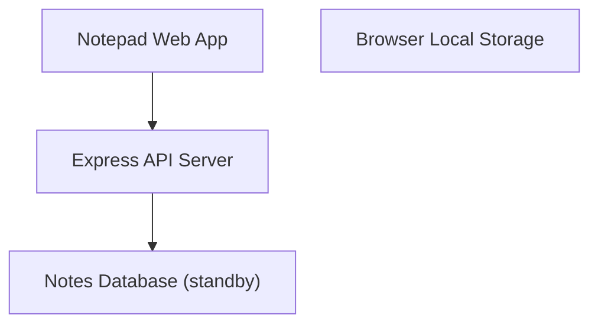
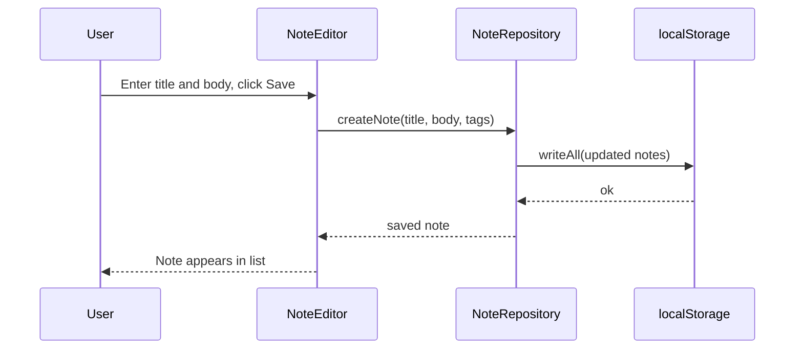
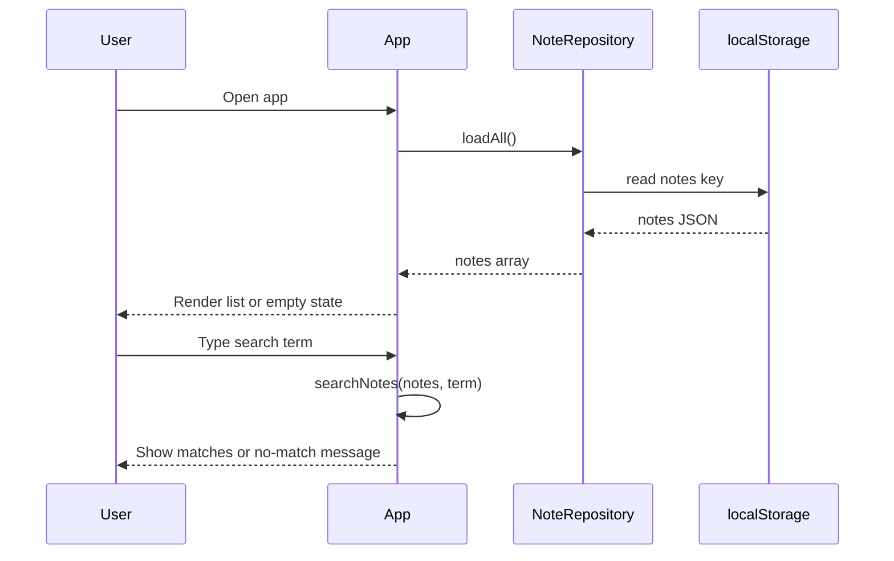
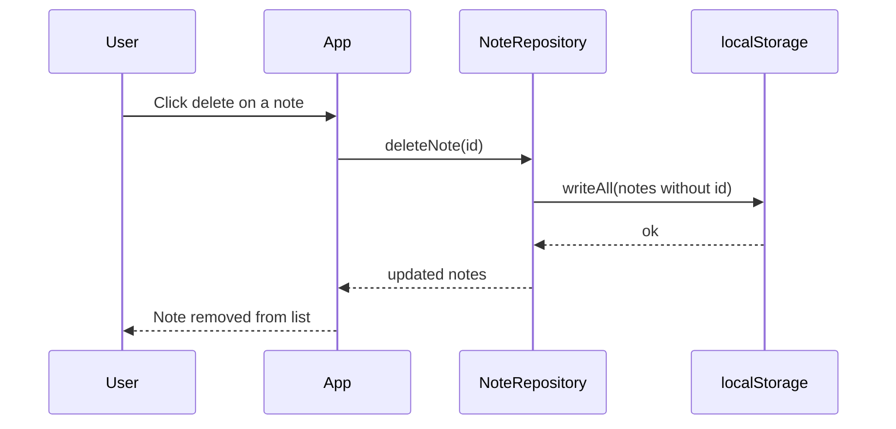
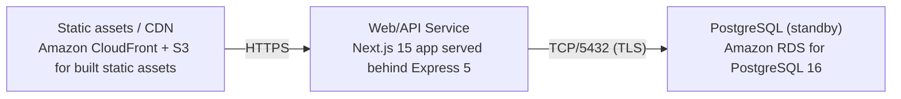

# Architecture

> Maintained by QuorQ AI SDLC. Text between `sdlc:auto` markers is regenerated; anything outside them is yours and is kept.

<!-- sdlc:auto:start narrative -->
## Overview

### ARCH-GAP-1 · draft

No architecture phase input has been provided.

Architecture phase has not started. No design documents, component diagrams, API contracts, data models, or screen inventories (e.g. SCR-xxx keys) were supplied, despite an approved technology stack (Express 5, AWS, PostgreSQL 16, Next.js 15) existing from the requirements phase.

- ⚠ Architecture/design phase has not started -- no design artifacts available to document.
<!-- sdlc:auto:end narrative -->

<!-- sdlc:auto:start building-blocks -->
## Building Block View

| ID | Name | Technology | Responsibility | Depends on |
|---|---|---|---|---|
| web_app | Notepad Web App | Next.js 15 | Responsive UI for creating, editing, deleting, browsing, searching and tag/folder filtering of plain-text notes. Owns all persistence by reading and writing the browser's localStorage. Renders empty states and no-match states. | api_server |
| local_store | Browser Local Storage | Browser localStorage (Web Storage API) | Durable client-side key-value store holding all notes and their tag/folder organization so they survive browser close and return visits on the same device. No server account, no sync (NFR-001, NFR-003). | — |
| api_server | Express API Server | Express 5 | Serves the built web app and exposes a health endpoint. On standby for future cloud backup/sync; today it performs no note persistence. | database |
| database | Notes Database (standby) | PostgreSQL 16 | PostgreSQL instance kept on standby. No note data is written today; schema is in place so adding cloud backup or multi-device sync later is a configuration change, not a rebuild. | — |

<!-- sdlc:auto:end building-blocks -->

<!-- sdlc:auto:start runtime -->
## Runtime View

### Create and persist a note

User enters a title and body (either may be empty) and saves. The note is written to localStorage and appears in the list. Plain text only -- no rich-text formatting is applied.

- **Components:** web_app, local_store
- **Modules:** NoteEditor, NoteRepository, useNotes
- **Key functions:** createNote(title, body, tags), saveNote(note), writeAll(notes)

### Load, browse and search on return visit

On app open, notes are read from localStorage and shown in a single scrollable list, or an empty state if none. The user types a search term and the list filters to notes whose title or body contains it, with a no-match indication when nothing matches.

- **Components:** web_app, local_store
- **Modules:** NotesList, SearchBar, NoteRepository, useNotes
- **Key functions:** loadAll(), searchNotes(notes, term), filterByTag(notes, tag)

### Delete a note

User deletes a note, which is permanently removed from localStorage so it no longer appears, including on later visits on the same device.

- **Components:** web_app, local_store
- **Modules:** NotesList, NoteRepository
- **Key functions:** deleteNote(id), writeAll(notes)

<!-- sdlc:auto:end runtime -->

<!-- sdlc:auto:start deployment-view -->
## Deployment View

| Name | Service | Runtime | Scaling | Environment |
|---|---|---|---|---|
| Web/API Service | Next.js 15 app served behind Express 5 | Node.js 20 on AWS (App Runner or Elastic Beanstalk) | Single small instance; traffic is tiny for a single-user app | dev |
| Static assets / CDN | Amazon CloudFront + S3 for built static assets | AWS managed | Edge-cached; auto | dev |
| PostgreSQL (standby) | Amazon RDS for PostgreSQL 16 | AWS managed, smallest instance | Single instance, on standby with no note writes today | dev |

| Source | Target | Protocol |
|---|---|---|
| Static assets / CDN | Web/API Service | HTTPS |
| Web/API Service | PostgreSQL (standby) | TCP/5432 (TLS) |

<!-- sdlc:auto:end deployment-view -->

<!-- sdlc:auto:start decisions -->
## Architecture Decisions

| Layer | Choice | ADR |
|---|---|---|
| Frontend | Next.js 15 | [ADR-0001](adr/frontend.md) |
| Backend | Express 5 | [ADR-0002](adr/backend.md) |
| Database | PostgreSQL 16 | [ADR-0003](adr/database.md) |
| Cloud | AWS | [ADR-0004](adr/cloud.md) |
<!-- sdlc:auto:end decisions -->

<!-- sdlc:auto:start links -->
## Related Documents

- [Data Model](data-model.md)
- [API Specification](api/openapi.yaml)
- [Architecture Decision Records](adr/README.md)
<!-- sdlc:auto:end links -->
