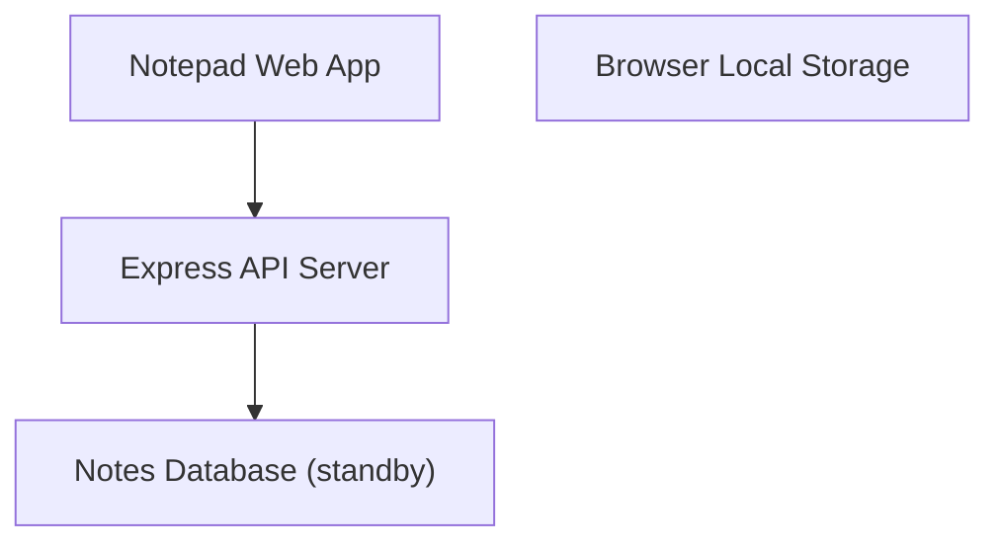
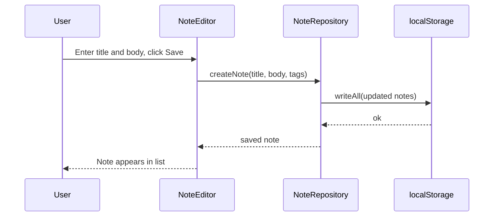
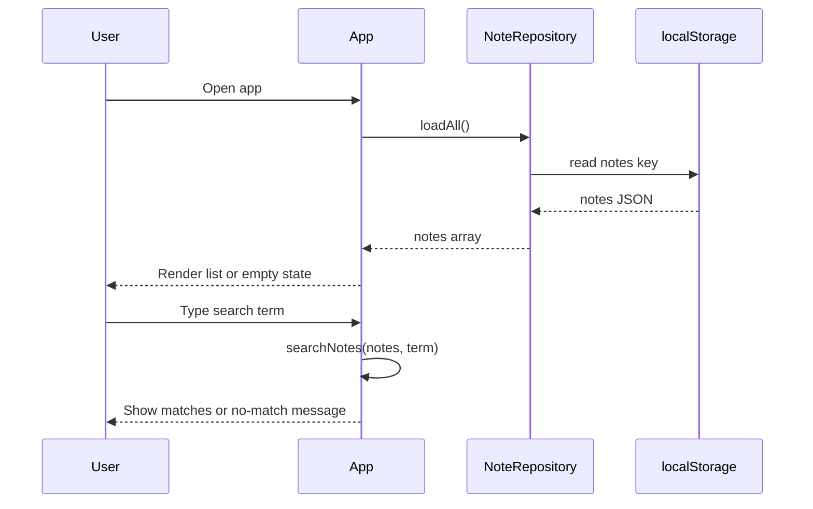
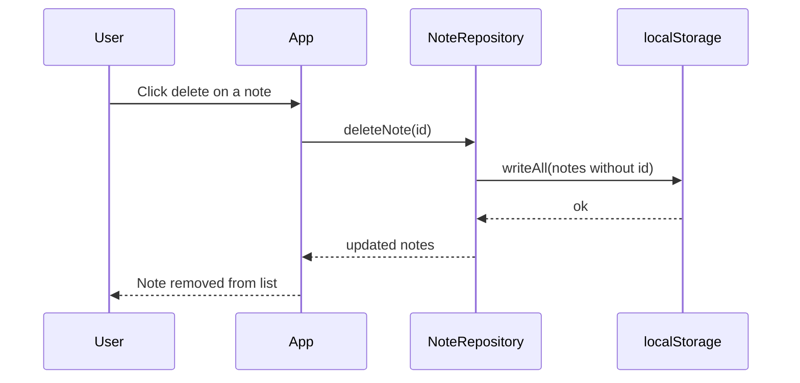
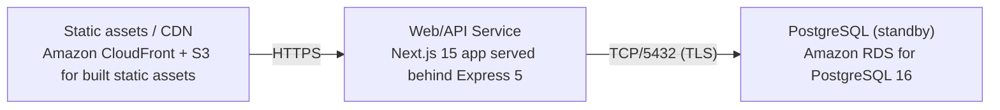

# Architecture

> Maintained by QuorQ AI SDLC. Text between `sdlc:auto` markers is regenerated; anything outside them is yours and is kept.

<!-- sdlc:auto:start narrative -->
## Overview

### ARCH-001 · approved · source: architecture:summary

Overall architecture is a lightweight, single-user, local-only notepad. All note data lives in browser localStorage with no login, no server-side account, and no cross-device sync. Backend and database exist but are on standby.

Version 1, status approved. The system is a responsive Next.js 15 web app where create, edit, delete, browse, search, and tag/folder filtering are all performed client-side against the browser's localStorage. An Express 5 backend and PostgreSQL 16 database are provisioned on AWS but today only serve the static app and a health check -- no note data flows through them. This design is intended to satisfy privacy and single-device requirements while keeping the door open: enabling cloud backup or sync later is meant to be a configuration change rather than a rebuild.

- ⚠ Input does not map this architecture to specific US-00x requirement ids; traceability from US-001..US-009 to architecture decisions is not explicit in the provided input.

### ARCH-COMP-WEB · approved · source: architecture:component:web_app

Notepad Web App (Next.js 15) is the sole UI and persistence owner, handling all note CRUD and search/filter operations directly against localStorage.

Component: Notepad Web App, technology Next.js 15. Responsive UI for creating, editing, deleting, browsing, searching, and tag/folder filtering of plain-text notes. Owns all persistence by reading and writing the browser's localStorage directly (no server round-trip for note data). Renders empty states (no notes yet) and no-match states (search yields nothing).

### ARCH-COMP-STORE · approved · source: architecture:component:local_store

Browser localStorage is the durable, single-device data store for all notes and their tag/folder organization -- no server account, no sync.

Component: Browser Local Storage, technology Browser localStorage (Web Storage API). Durable client-side key-value store holding all notes and their tag/folder organization so they survive browser close and return visits on the same device. Explicitly satisfies NFR-001 and NFR-003 (no server account, no cross-device sync) per the architecture input.

**Related:** NFR-001, NFR-003

### ARCH-COMP-API · approved · source: architecture:component:api_server

Express 5 API server currently only serves the built web app and a health endpoint; it is on standby for future backup/sync features.

Component: Express API Server, technology Express 5. Serves the built Next.js web app and exposes a health endpoint. Performs no note persistence today. Positioned for future cloud backup/sync functionality.

### ARCH-COMP-DB · approved · source: architecture:component:database

PostgreSQL 16 database is provisioned but on standby -- no note data is written to it today; schema exists for future enablement.

Component: Notes Database (standby), technology PostgreSQL 16. No note data is written today. The schema is already in place so that enabling cloud backup or multi-device sync later is a configuration change rather than a rebuild.

### ARCH-FLOW-CREATE · approved · source: architecture:critical_path:create_and_persist

Creating a note: user enters title and body (either may be empty), saves, and it is written to localStorage and appears in the list immediately, as plain text only.

Critical path 'Create and persist a note': User enters a title and body (either may be empty) and saves. The note is written to localStorage and appears in the list. Plain text only -- no rich-text formatting is applied.

- ⚠ Not explicitly linked to a specific US-00x requirement id in the provided input.

### ARCH-FLOW-LOAD · approved · source: architecture:critical_path:load_browse_search

On app open, notes load from localStorage into a scrollable list (or empty state); typing a search term filters by title/body match, with a no-match indicator when nothing matches.

Critical path 'Load, browse and search on return visit': On app open, notes are read from localStorage and shown in a single scrollable list, or an empty state if none exist. The user types a search term and the list filters to notes whose title or body contains it, with a no-match indication when nothing matches.

- ⚠ Not explicitly linked to a specific US-00x requirement id in the provided input.

### ARCH-FLOW-DELETE · approved · source: architecture:critical_path:delete_a_note

Deleting a note permanently removes it from localStorage so it no longer appears, including on later visits on the same device.

Critical path 'Delete a note': User deletes a note, which is permanently removed from localStorage so it no longer appears, including on later visits on the same device.

- ⚠ Not explicitly linked to a specific US-00x requirement id in the provided input.

### ARCH-DATA-MODEL · approved · source: architecture:entities

Data model consists of three entities: note, tag, and a note_tag join table, mirrored between the client-side localStorage shape and the standby PostgreSQL schema.

Entities defined: note(id, title, body, folder, created_at, updated_at); tag(id, name); note_tag(note_id, tag_id) as the join table linking notes to tags. This schema shape is used both in localStorage today and in the standby PostgreSQL 16 database for future enablement.

### ARCH-API-HEALTH · approved · source: architecture:endpoint:GET /api/health

Single API endpoint, GET /api/health, is a liveness check used by deployment health checks and does not touch note data.

Endpoint: GET /api/health - Liveness check for the Express server; used by deployment health checks. Does not touch note data. This is the only backend endpoint defined in the current architecture.

### ARCH-DEPLOY · approved · source: architecture:deployment_nodes

Deployment topology: Next.js app served behind Express on Node.js 20 via AWS App Runner or Elastic Beanstalk, static assets via CloudFront+S3, and a standby RDS PostgreSQL instance.

Deployment nodes: (1) Web/API Service -- Next.js 15 app served behind Express 5, Node.js 20, on AWS (App Runner or Elastic Beanstalk). (2) Static assets / CDN -- Amazon CloudFront + S3 for built static assets, AWS managed. (3) PostgreSQL (standby) -- Amazon RDS for PostgreSQL 16, AWS managed, smallest instance size.

- ⚠ Choice between App Runner and Elastic Beanstalk for the Web/API Service is not finalized in the input -- both are listed as options.

### ARCH-TECH-FRONTEND · approved · source: architecture:technology_decision:frontend

Frontend technology chosen is Next.js 15, over alternatives Remix and Vite+React.

Decision: Next.js 15 (alternatives considered: Remix, Vite + React). Rationale given: delivers the entire responsive notepad UI and client-side logic; all note persistence is handled in the browser via localStorage with no server round-trips, satisfying the local-only, no-account design.

### ARCH-TECH-BACKEND · approved · source: architecture:technology_decision:backend

Backend technology chosen is Express 5, over alternatives Fastify and NestJS.

Decision: Express 5 (alternatives considered: Fastify, NestJS). Rationale given: serves the built app and a health endpoint; kept minimal because no note data flows through the server in the current single-device design.

### ARCH-TECH-DB · approved · source: architecture:technology_decision:database

Database technology chosen is PostgreSQL 16 on standby, over alternatives SQLite and DynamoDB.

Decision: PostgreSQL 16 (alternatives considered: SQLite, DynamoDB). Rationale given: on standby to host notes if cloud backup or multi-device sync is enabled; the standby schema mirrors the client-side note shape so enablement is configuration, not a rebuild.

### ARCH-TECH-CLOUD · approved · source: architecture:technology_decision:cloud

Cloud provider chosen is AWS, listed as the only hosting option considered against Vercel and Cloudflare.

Decision: AWS (alternatives considered: Vercel, Cloudflare). Rationale given: AWS is the only hosting option selected; it inexpensively serves a small static web app to desktop and mobile browsers with traffic near the floor for a single user.
<!-- sdlc:auto:end narrative -->

<!-- sdlc:auto:start building-blocks -->
## Building Block View

| ID | Name | Technology | Responsibility | Depends on |
|---|---|---|---|---|
| web_app | Notepad Web App | Next.js 15 | Responsive UI for creating, editing, deleting, browsing, searching and tag/folder filtering of plain-text notes. Owns all persistence by reading and writing the browser's localStorage. Renders empty states and no-match states. | api_server |
| local_store | Browser Local Storage | Browser localStorage (Web Storage API) | Durable client-side key-value store holding all notes and their tag/folder organization so they survive browser close and return visits on the same device. No server account, no sync (NFR-001, NFR-003). | — |
| api_server | Express API Server | Express 5 | Serves the built web app and exposes a health endpoint. On standby for future cloud backup/sync; today it performs no note persistence. | database |
| database | Notes Database (standby) | PostgreSQL 16 | PostgreSQL instance kept on standby. No note data is written today; schema is in place so adding cloud backup or multi-device sync later is a configuration change, not a rebuild. | — |

<!-- sdlc:auto:end building-blocks -->

<!-- sdlc:auto:start runtime -->
## Runtime View

### Create and persist a note

User enters a title and body (either may be empty) and saves. The note is written to localStorage and appears in the list. Plain text only -- no rich-text formatting is applied.

- **Components:** web_app, local_store
- **Modules:** NoteEditor, NoteRepository, useNotes
- **Key functions:** createNote(title, body, tags), saveNote(note), writeAll(notes)

### Load, browse and search on return visit

On app open, notes are read from localStorage and shown in a single scrollable list, or an empty state if none. The user types a search term and the list filters to notes whose title or body contains it, with a no-match indication when nothing matches.

- **Components:** web_app, local_store
- **Modules:** NotesList, SearchBar, NoteRepository, useNotes
- **Key functions:** loadAll(), searchNotes(notes, term), filterByTag(notes, tag)

### Delete a note

User deletes a note, which is permanently removed from localStorage so it no longer appears, including on later visits on the same device.

- **Components:** web_app, local_store
- **Modules:** NotesList, NoteRepository
- **Key functions:** deleteNote(id), writeAll(notes)

<!-- sdlc:auto:end runtime -->

<!-- sdlc:auto:start deployment-view -->
## Deployment View

| Name | Service | Runtime | Scaling | Environment |
|---|---|---|---|---|
| Web/API Service | Next.js 15 app served behind Express 5 | Node.js 20 on AWS (App Runner or Elastic Beanstalk) | Single small instance; traffic is tiny for a single-user app | dev |
| Static assets / CDN | Amazon CloudFront + S3 for built static assets | AWS managed | Edge-cached; auto | dev |
| PostgreSQL (standby) | Amazon RDS for PostgreSQL 16 | AWS managed, smallest instance | Single instance, on standby with no note writes today | dev |

| Source | Target | Protocol |
|---|---|---|
| Static assets / CDN | Web/API Service | HTTPS |
| Web/API Service | PostgreSQL (standby) | TCP/5432 (TLS) |

<!-- sdlc:auto:end deployment-view -->

<!-- sdlc:auto:start decisions -->
## Architecture Decisions

| Layer | Choice | ADR |
|---|---|---|
| Frontend | Next.js 15 | [ADR-0001](adr/frontend.md) |
| Backend | Express 5 | [ADR-0002](adr/backend.md) |
| Database | PostgreSQL 16 | [ADR-0003](adr/database.md) |
| Cloud | AWS | [ADR-0004](adr/cloud.md) |
<!-- sdlc:auto:end decisions -->

<!-- sdlc:auto:start links -->
## Related Documents

- [Data Model](data-model.md)
- [API Specification](api/openapi.yaml)
- [Architecture Decision Records](adr/README.md)
<!-- sdlc:auto:end links -->
