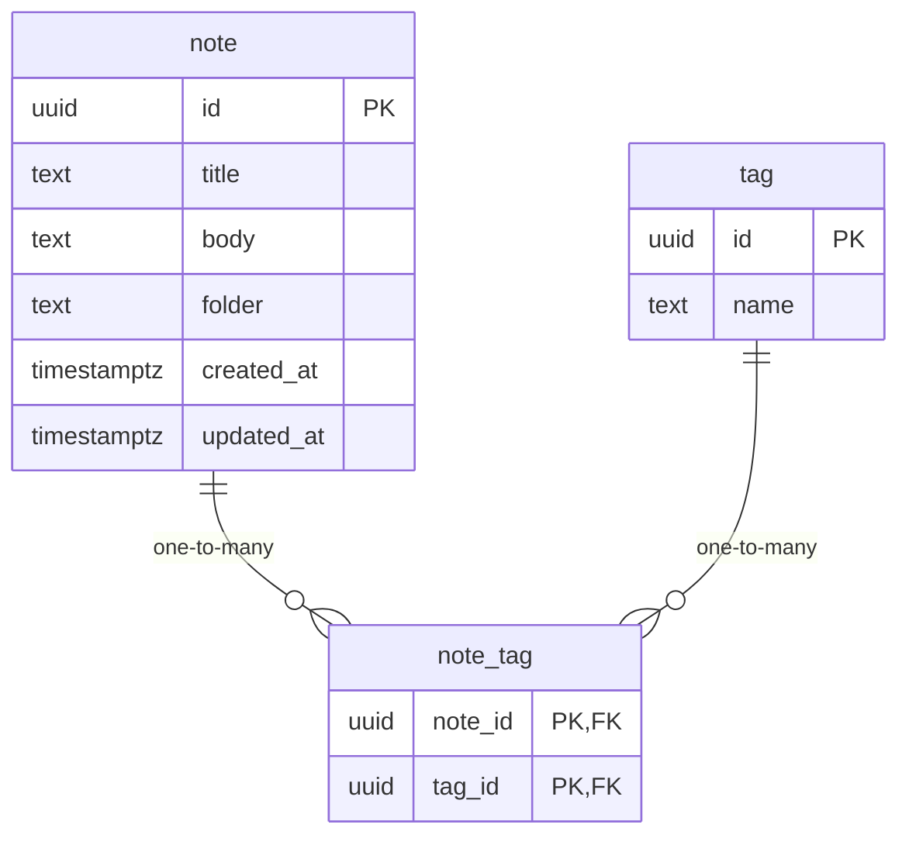

# Data Model

<!-- sdlc:auto:start entities -->
### note

| Field | Type | PK | FK | Nullable |
|---|---|---|---|---|
| id | uuid | True | — | False |
| title | text | False | — | True |
| body | text | False | — | True |
| folder | text | False | — | True |
| created_at | timestamptz | False | — | False |
| updated_at | timestamptz | False | — | False |

### tag

| Field | Type | PK | FK | Nullable |
|---|---|---|---|---|
| id | uuid | True | — | False |
| name | text | False | — | False |

### note_tag

| Field | Type | PK | FK | Nullable |
|---|---|---|---|---|
| note_id | uuid | True | note.id | False |
| tag_id | uuid | True | tag.id | False |
<!-- sdlc:auto:end entities -->

<!-- sdlc:auto:start relationships -->
| Source | Target | Type |
|---|---|---|
| note | note_tag | one-to-many |
| tag | note_tag | one-to-many |
<!-- sdlc:auto:end relationships -->

<!-- sdlc:auto:start er-diagram -->

<!-- sdlc:auto:end er-diagram -->
