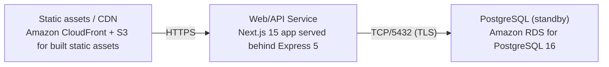

# Deployment Guide

> Maintained by QuorQ AI SDLC. Text between `sdlc:auto` markers is regenerated; anything outside them is yours and is kept.

<!-- sdlc:auto:start how-it-deploys -->
Pushes to `main` run `.github/workflows/deploy.yml`, which builds the API image (if there is a backend) and deploys the SPA to AWS Amplify. Commits touching only `docs/sdlc/**` don't deploy. Deployments can also be started from the platform's Deployment tab.
<!-- sdlc:auto:end how-it-deploys -->

<!-- sdlc:auto:start environments -->
| Name | Service | Runtime | Scaling | Environment |
|---|---|---|---|---|
| Web/API Service | Next.js 15 app served behind Express 5 | Node.js 20 on AWS (App Runner or Elastic Beanstalk) | Single small instance; traffic is tiny for a single-user app | dev |
| Static assets / CDN | Amazon CloudFront + S3 for built static assets | AWS managed | Edge-cached; auto | dev |
| PostgreSQL (standby) | Amazon RDS for PostgreSQL 16 | AWS managed, smallest instance | Single instance, on standby with no note writes today | dev |
<!-- sdlc:auto:end environments -->

<!-- sdlc:auto:start live -->
_Not deployed yet._
<!-- sdlc:auto:end live -->

<!-- sdlc:auto:start topology -->

<!-- sdlc:auto:end topology -->
